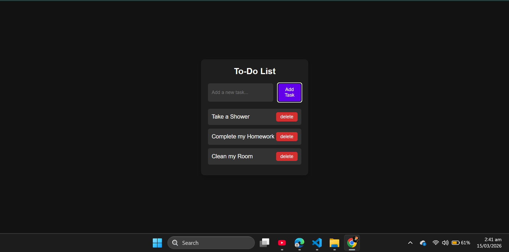

# 📝 Dark Mode To-Do List

_A simple, dark-themed to-do list built with vanilla JavaScript that actually remembers your tasks when you close the tab._

---

## 📌 Table of Contents

- <a href="#overview">Overview</a>
- <a href="#problem-statement">Problem Statement</a>
- <a href="#dataset">Dataset</a>
- <a href="#tools--technologies">Tools and Technologies</a>
- <a href="#methods">Methods</a>
- <a href="#key-insights">Key Insights</a>
- <a href="#dashboard">Dashboard/Model/Output</a>
- <a href="#how-to-run">How to Run this project?</a>
- <a href="#results--conclusion">Results & Conclusion</a>
- <a href="#author--contact">Author & Contact</a>

---

<h2><a class="anchor" id="overview"></a>Overview</h2>

I built this project because I wanted a lightweight, no-nonsense way to keep track of my daily tasks. It’s built entirely with HTML, CSS, and JavaScript. It features a modern dark mode interface (because who doesn't love dark mode?) and uses your browser's local storage, so you don't lose your list if you accidentally refresh the page or close your browser.

---

<h2><a class="anchor" id="problem-statement"></a>Problem Statement</h2>

Most to-do apps are way too complicated. You have to create an account, navigate through endless menus, and deal with bright white screens that can strain your eyes. I just wanted a quick, distraction-free tool to jot things down, cross them off, and have it waiting for me the next day without any hassle.

---

<h2><a class="anchor" id="dataset"></a>Dataset</h2>

All data is generated by the user and saved securely right in their own browser using the Web Storage API.

---

<h2><a class="anchor" id="tools--technologies"></a>Tools and Technologies</h2>

- **HTML5:** To structure the app.
- **CSS3:** For the dark theme, flexbox layout, and hover effects.
- **JavaScript (ES6+):** To handle the logic and make it interactive.
- **Web Storage API:** Specifically `localStorage` to keep the data saved between sessions.

---

<h2><a class="anchor" id="methods"></a>Methods</h2>

Behind the scenes, the app takes what you type and dynamically creates new list items on the page. I used a JavaScript array to keep track of the tasks and synced it up with `localStorage` (using `JSON.stringify` and `JSON.parse`).

A fun little challenge was dealing with click events. I had to use `e.stopPropagation()` on the delete buttons—otherwise, clicking "delete" would also trigger the "mark as done" action on the task underneath it!

---

<h2><a class="anchor" id="key-insights"></a>Key Insights</h2>

- I realized how important event bubbling is; isolating that delete button click saved me a lot of weird UI bugs.
- `localStorage` is incredibly powerful for building quick, useful tools without needing to set up a whole backend database.

---

<h2><a class="anchor" id="dashboard"></a>Output</h2>



The final output is a clean, centralized interface. It has a text box, an "Add Task" button, and your list. When you finish a task, it gets a satisfying strikethrough and fades back a bit so you can focus on what's left.

---

<h2><a class="anchor" id="how-to-run"></a>How to Run this project?</h2>

It couldn't be easier:

1. Clone or download this repo to your computer.

```bash
git clone [https://github.com/MujtabaFarooqui7/dark-mode-todo.git](https://github.com/MujtabaFarooqui7/dark-mode-todo.git)
```
